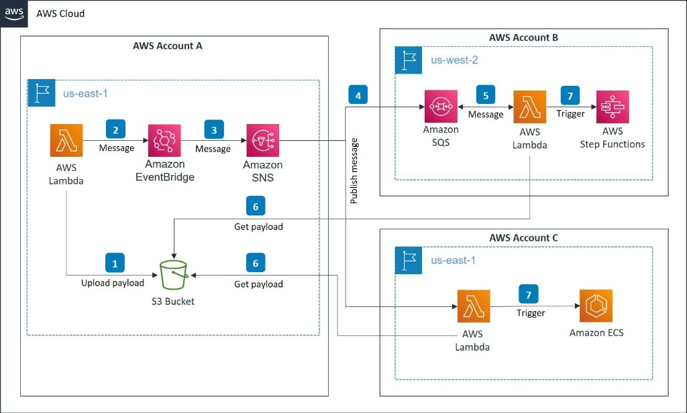

# ADR-001 — Modernização da Plataforma de Governança de Dados AWS

**ECS/Fargate · Python/FastAPI · Coreografia SQS · DynamoDB · Step Functions Express**

- **Versão:** 1.0  
- **Data:** 28/10/2026  
- **Status:** Aprovada  
- **Restrição obrigatória:** AWS Step Functions **Express**. O uso de Standard é proibido.

---

## 1. Visão Geral da Arquitetura Multi-Conta

A plataforma modernizada atende à arquitetura distribuída multi-conta ilustrada abaixo:

### Mapeamento das Contas AWS

1. **AWS Account A (us-east-1) — Producer / Requester:**
   - **Step 1:** Lambda faz upload do payload completo da concessão para o bucket S3 `sg-governance-payloads`.
   - **Step 2:** Emite evento de notificação para o Amazon EventBridge (`sg-governance-bus`).
   - **Step 3:** EventBridge roteia o evento para o Amazon SNS (`sg-share-events-topic`).

2. **AWS Account C (us-east-1) — Plataforma de Execução (ECS / Fargate):**
   - **Step 4:** SNS notifica o serviço de entrada da governança (`intake-service`).
   - **Step 6:** O serviço obtém o payload detalhado a partir do bucket S3 da Account A.
   - **Step 7:** Dispara a coreografia de negócio no Amazon ECS/Fargate através da primeira fila SQS (`access-validation`).
   - Os 6 microserviços ECS executam sequencialmente e de forma desacoplada via SQS:
     1. `account-validation-service` (`access-validation`)
     2. `catalog-validation-service` (`database-validation`)
     3. `resource-sharing-service` (`resource-sharing`)
     4. `share-acceptance-service` (`share-acceptance`)
     5. `resource-link-service` (`resource-links`)
     6. `permissions-service` (`permissions`)
   - Cada serviço persiste seu estado no DynamoDB (`sg-share-governance`) com `PK=REQUEST#<requestId>` e `SK=STEP#<stepName>#ATTEMPT#<attemptId>`.
   - Ao final, publica evento terminal em `workflow-completed` (sucesso) ou `workflow-failed` (falha).

3. **AWS Account B (us-west-2) — Auditoria e Diagnóstico Visual:**
   - **Step 4 / 5:** O Amazon SQS recebe o evento terminal.
   - **Step 5 / 6:** Consumidor Lambda/Worker lê o evento (e payload se necessário).
   - **Step 7:** Inicia a execução da máquina **AWS Step Functions Express** (`GovernanceDiagnosticWorkflow`).
   - **Step 8:** A máquina Express consulta retrospectivamente cada etapa chamando `POST /internal/checkStep` no `checkstep-service`.
   - Se todas concluírem com sucesso, finaliza no ramo `Success`. Ao detectar a primeira etapa `FAILED`, desvia imediatamente para o ramo `Failure`.
   - Publica o resultado consolidado e alertas operacionais no Amazon SNS (`sg-governance-notifications`).

---

## 2. Decisão de Arquitetura e Padrões

1. **Separação de Responsabilidades:** O processamento de negócio é executado de forma coreografada pelos microserviços ECS consumindo SQS. A Step Functions Express **não orquestra** os serviços; ela é utilizada exclusivamente para a **reconstrução visual pós-processamento**.
2. **Fonte de Verdade:** O DynamoDB é a fonte autoritativa de verdade para os estados e metadados de cada etapa.
3. **Idempotência:** Cada etapa utiliza chave determinística `requestId#attemptId#stepName` para garantir que retries de mensagens SQS não causem efeitos colaterais duplicados.
4. **Isolamento e DLQs:** Cada fila SQS de trabalho possui sua respectiva Dead-Letter Queue (DLQ).
